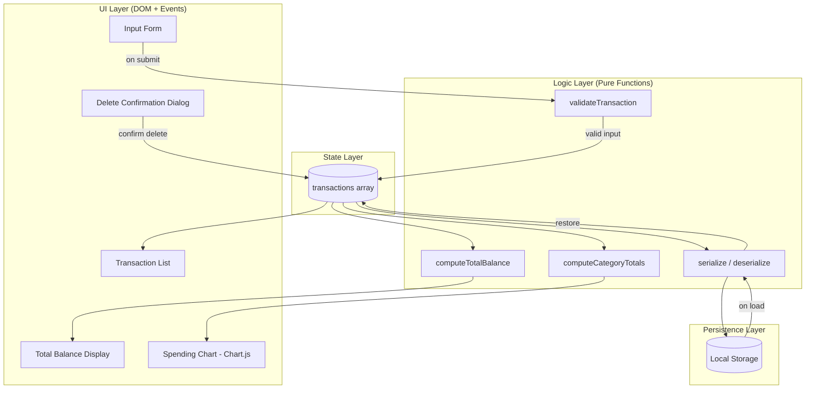

# Design Document

## Overview

The Expense & Budget Visualizer is a standalone, mobile-friendly web application that lets users record daily spending, review a scrollable transaction history, see a live total balance, and view a pie chart of spending broken down by category. It runs entirely in the browser: opening its HTML file directly requires no build step, no server, and no framework.

The design is guided by one principle: **separate pure business logic from DOM and I/O concerns**. Validation, balance computation, category aggregation, and (de)serialization are implemented as pure functions with no side effects. The DOM rendering, event handling, Chart.js integration, and Local Storage access form a thin shell around that logic. This separation is what makes the core behavior verifiable with property-based testing while the UI is covered by example-based tests.

Key constraints shaping the design:

- **No framework, no build step** (Requirements 6.1, 6.3): plain HTML/CSS/Vanilla JS, opened directly via `file://`. ES modules are deliberately avoided because they are blocked by Chrome's `file://` CORS policy, which would violate cross-browser support (6.2). A traditional `<script>` with an IIFE module pattern is used instead.
- **Chart.js via CDN** (Requirement 6.1): loaded through a `<script>` tag in `index.html`. Requirement 7.2 assumes an active connection, so a CDN satisfies "no build step or installation" while keeping `js/` to a single application file. The chart layer degrades gracefully if the library fails to load.
- **Local Storage with feature detection** (Requirement 5.3): because `file://` origins are treated inconsistently across browsers (Chrome/Edge share a "null" origin bucket; Firefox/Safari may restrict or disable storage), every storage operation is wrapped in try/catch. The app falls back to in-memory-only operation with a user-facing notice when storage is unavailable.
- **Single source of truth**: an in-memory `transactions` array drives all three views (list, balance, chart). Every mutation re-derives the views from that array, keeping the UI always consistent.

## Architecture

The application is organized into three logical layers that live within a single `js/app.js` file. The layers are conceptual, not physical, so the file-count constraint ("only 1 JavaScript file inside `js/`") is satisfied while internal cohesion is maintained.



**Layer responsibilities:**

- **Logic Layer** — pure functions with no DOM or storage access. `validateTransaction` checks input against the rules, `computeTotalBalance` sums amounts, `computeCategoryTotals` aggregates per category, and `serialize`/`deserialize` convert between the in-memory model and JSON. These are the only functions targeted by property-based tests.
- **State Layer** — the in-memory `transactions` array, the single source of truth. Mutating functions (`addTransaction`, `deleteTransaction`) validate input, append/remove, then trigger a full re-render and persist.
- **UI Layer** — DOM rendering and event wiring. It reads from the state array and writes to the DOM. The chart sub-component wraps Chart.js, rebuilding or updating the pie chart from the category totals.
- **Persistence Layer** — a thin adapter over `localStorage`. It feature-detects availability and exposes `save`/`load` calls that never throw to the caller; failures surface as in-memory fallback.

**Data flow on a mutation (add or delete):**

1. A user action fires (form submit, delete confirm).
2. The handler validates input (for adds) and mutates the `transactions` array.
3. `renderAll()` is invoked: it re-renders the list, recomputes and writes the total balance, and recomputes and updates the chart.
4. `persist()` serializes the array and writes to Local Storage (wrapped in try/catch).
5. If persistence fails, an error notice is shown but the in-memory list is retained (Requirement 5.3).

**Data flow on load:**

1. `init()` runs on `DOMContentLoaded`.
2. `load()` reads and deserializes Local Storage; on success the `transactions` array is restored, on failure (unavailable/invalid) it starts empty.
3. `renderAll()` populates the list, balance, and chart from the restored state.

### Design Decisions and Rationale

| Decision | Choice | Rationale |
|---|---|---|
| Module system | Traditional `<script>` + IIFE | ES modules are blocked on `file://` in Chrome, violating 6.2/6.3. IIFE keeps a clean public API for testing. |
| Chart.js delivery | CDN `<script>` tag | No build step or install (6.3); connectivity is assumed (7.2); keeps `js/` to one file. |
| State management | Single in-memory array + full re-render | Simple, predictable, and always consistent across the three views. Re-deriving views from one source avoids drift bugs. |
| Storage strategy | Feature-detect + try/catch + in-memory fallback | `file://` storage support varies by browser; 5.3 requires graceful degradation. |
| ID generation | `crypto.randomUUID()` with fallback | Stable unique IDs for delete targeting; `crypto.randomUUID` is available in all target browsers, with a timestamp-random fallback for safety. |
| Numeric handling | Integer cents internally | Floating-point sum errors are avoided by working in cents; amounts are parsed to cents on input and formatted to 2 decimals on display. |

## Components and Interfaces

All components live in `js/app.js` and are exposed through a single global namespace, `ExpenseViz`. Only the pure logic functions and the public actions are exported for testability; DOM internals remain private to the IIFE.

### File Layout

```
/
├── index.html          # structure, CDN script tag for Chart.js
├── css/
│   └── styles.css      # single stylesheet
└── js/
    └── app.js          # single application script (IIFE module)
```

### Logic Layer — Pure Functions

```
validateTransaction(input: RawInput): ValidationResult
  // Checks itemName length (1-100, trimmed non-empty), amount is a
  // finite number in [0.01, 999999999.99], and category is in the
  // allowed set. Returns { valid, errors } with a message per invalid
  // field. No side effects.

computeTotalBalance(transactions: Transaction[]): number
  // Returns the sum of all transaction amounts in cents. Empty list -> 0.

computeCategoryTotals(transactions: Transaction[]): CategoryTotals
  // Returns { Food, Transport, Fun } where each value is the sum of
  // amounts for that category, always including zero-total categories.

serializeTransactions(transactions: Transaction[]): string
  // JSON-encodes the array with a schema version tag for forward
  // compatibility. Pure: input -> output string.

deserializeTransactions(data: string): Transaction[] | null
  // Parses and validates a stored string back into a Transaction[].
  // Returns null on any parse/schema/shape failure. Inverse of serialize.
```

### State Layer — Mutating Actions

```
addTransaction(input: RawInput): { ok: boolean, errors?: ValidationErrors }
  // Validates input; if invalid returns errors without mutating state.
  // If valid, appends a new Transaction (with generated id) to the
  // array, re-renders, and persists. Returns ok on success.

deleteTransaction(id: string): void
  // Removes the transaction with the given id, re-renders, and persists.
```

### UI Layer — Rendering and Events

```
renderAll(): void
  // Orchestrates renderTransactionList, renderTotalBalance, renderChart.

renderTransactionList(): void
  // Rebuilds the list DOM from the transactions array; shows the empty
  // state when the array is empty; attaches a delete control per row.

renderTotalBalance(): void
  // Writes the formatted total (2 decimals) to the balance element.

renderChart(): void
  // If Chart.js is loaded and there is data, renders/updates the pie
  // chart from computeCategoryTotals. If no data, shows the
  // "no spending data" message and hides the canvas.

handleFormSubmit(event: SubmitEvent): void
  // Prevents default, reads form fields, calls addTransaction, shows
  // inline validation messages on failure, clears fields on success.

handleDeleteClick(id: string): void
  // Shows a confirmation prompt; on confirm calls deleteTransaction.

showValidationErrors(errors: ValidationErrors): void
  // Renders per-field validation messages near the inputs.

showStorageError(message: string): void
  // Displays a non-blocking notice that persistence failed.
```

### Persistence Layer

```
isStorageAvailable(): boolean
  // Feature-detects localStorage with a probe write/read/remove.

save(transactions: Transaction[]): boolean
  // Serializes and writes to localStorage; returns false and shows a
  // notice on failure. Never throws.

load(): Transaction[] | null
  // Reads and deserializes; returns null when unavailable/empty/invalid.
```

### Public API (for testing)

The IIFE returns an object exposing the pure functions and `addTransaction`/`deleteTransaction`/`init` so property and example tests can drive them directly:

```
ExpenseViz = {
  validateTransaction, computeTotalBalance, computeCategoryTotals,
  serializeTransactions, deserializeTransactions,
  addTransaction, deleteTransaction, init
}
```

## Data Models

All amounts are represented internally as integer cents to avoid floating-point drift; they are formatted to two decimal places only at display time.

### RawInput (form fields, before validation)

```json
{
  "itemName": "string",
  "amount": "string",   // raw text from the field, parsed to cents during validation
  "category": "Food" | "Transport" | "Fun"
}
```

### Transaction (canonical stored form)

```json
{
  "id": "uuid-string",
  "itemName": "string",
  "amountCents": 0,
  "category": "Food" | "Transport" | "Fun"
}
```

- `id`: unique identifier (from `crypto.randomUUID()`, fallback to timestamp+random).
- `itemName`: trimmed, non-empty, length 1-100.
- `amountCents`: integer cents, range 1 to 99999999999 (i.e. 0.01 to 999999999.99).
- `category`: one of the three allowed values.

### ValidationResult

```json
{
  "valid": true,
  "errors": {
    "itemName": "string | null",
    "amount": "string | null",
    "category": "string | null"
  }
}
```

`valid` is true only when all three fields have null error messages.

### CategoryTotals

```json
{
  "Food": 0,
  "Transport": 0,
  "Fun": 0
}
```

All three keys are always present, even when their total is zero (Requirement 4.1).

### Persisted Storage Format

```json
{
  "version": 1,
  "transactions": [Transaction, ...]
}
```

The `version` field supports future schema migration. `deserializeTransactions` rejects payloads whose `version` is missing or unsupported, returning `null` so the app initializes empty (Requirement 5.4).
